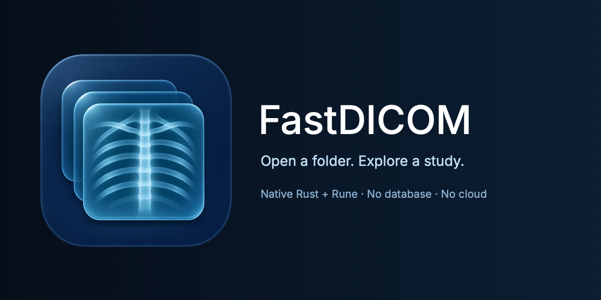

<p align="center">
  
</p>

A small, native DICOM viewer for macOS. No library to manage, no database to
maintain, no cloud uploads—just your images and the tools to explore them.

Built in Rust with [Rune](https://github.com/anomalyco/rune), without a webview.
An experiment in making medical-image viewing feel simple, local, and immediate.

**Experimental software. Not validated for diagnostic interpretation.**

## Try it

On Apple Silicon macOS, with the pinned Rust toolchain:

```sh
cargo run --locked -- /path/to/dicom-folder
```

Or run without a path and choose **Open folder** or **Synthetic demo**.

Try the included [sample pack](samples/README.txt): three studies, four series,
and 82 images. Open `samples/` to browse them.

See the [guide](docs/guide.md) for controls, supported formats, privacy limits,
local app bundling, and verification commands.

## References

- Synthetic CT/MR samples: [CharruaSoft DICOM Samples](https://www.charruasoft.com/dicom-samples), CC0 1.0.
- Chest radiographs: Armato et al., [LIDC-IDRI / TCIA](https://doi.org/10.7937/K9/TCIA.2015.LO9QL9SX), CC BY 3.0; modified demo demographics.

Full attribution, changes, and usage terms are included with the [samples](samples/README.txt).
